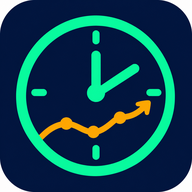
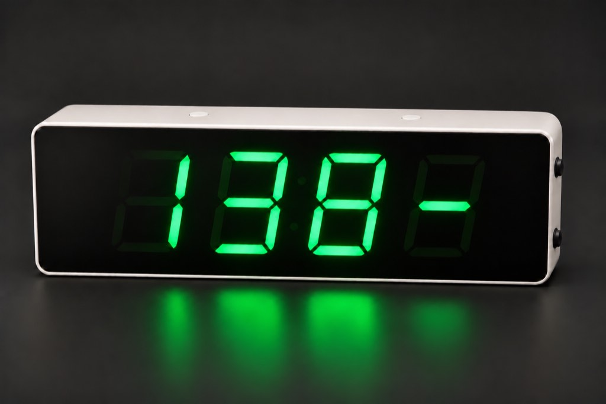
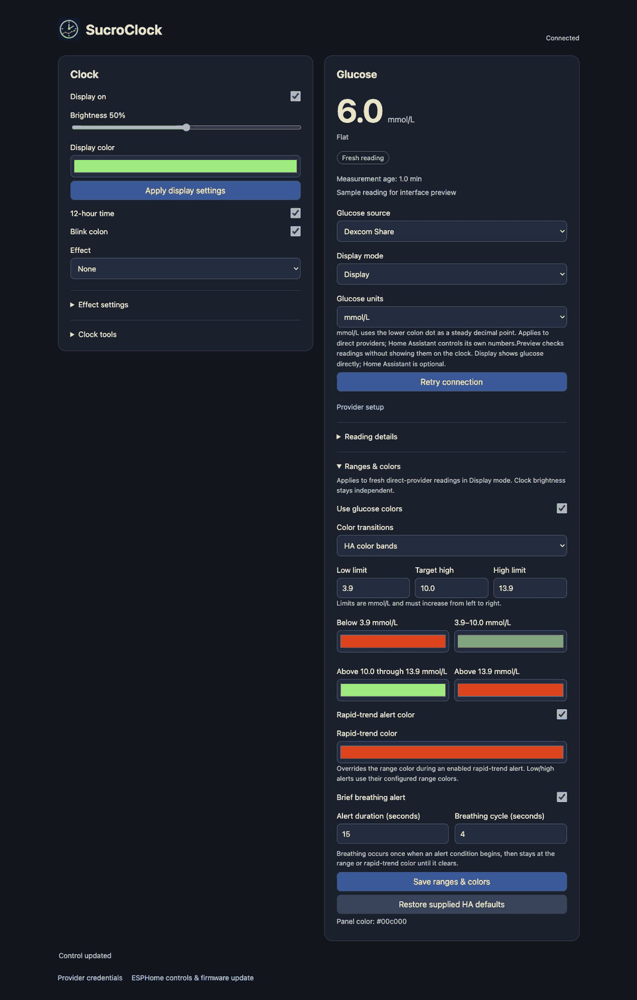

# SucroClock

**Glucose at a glance.**

An open-source ESP32 glucose clock for the HU-058D display. It connects directly
to your glucose provider and offers local web controls, configurable colors,
trend glyphs and firmware updates over Wi-Fi. Home Assistant is suppored but optional.

*Rendered illustration using sample data; the final built device may differ slightly.*

## Features

- Separate Dexcom Share, LibreLinkUp, Nightscout, SugarSense and Home Assistant sources.
- Local HTTPS setup and controls; provider credentials stored on the clock.
- mg/dL or mmol/L readings and range controls; adjustable colors, smooth blending and brief breathing alerts.
- Preview/Display modes, freshness checks and explicit source selection.
- Clock effects, brightness, buttons and custom trend glyphs.
- Browser OTA, native ESPHome OTA and fallback Wi-Fi provisioning.

*Interface preview using sample glucose data, with mmol/L readings and range controls.*

## Buying the hardware

**You must buy a separate ESP32 development board to run SucroClock. The
ESP8266 / ESP-01S supplied with the Wi-Fi clock kit cannot run this firmware.**
The kit supplies the display, enclosure and clock PCB; convert it using the
[wiring guide](docs/wiring.md). This is a DIY build, not a ready-made glucose clock.

| Store | Base clock kit | Listing notes |
| --- | --- | --- |
| Amazon US | [Segrehy ESP8266 WiFi Clock Kit (white)](https://www.amazon.com/dp/B0FCCG11XB) | Listing opened and advertised in stock on 2026-11-22; exact PCB revision has not been physically verified. |
| AliExpress | [HU-058D / ESP8266 IoT Colorful WiFi Clock Kit](https://www.aliexpress.us/item/3256807371597845.html) | Original listing linked by Adrian's hardware documentation; currently unavailable for the location used during our 2026-11-22 check. Availability varies by destination. |

Also buy a **classic ESP32-WROOM-32 development board** exposing GPIO18, GPIO19,
GPIO21, GPIO22, GPIO32 and GPIO33 for the supplied `esp32dev` configuration.
ESP32-C3/S2/S3 boards are not drop-in replacements for this wiring/configuration.
Check the seller's board photos/model before ordering: similar-looking clock
kits may use different electronics. Prices, stock and shipping can change.
See [buying notes](docs/buying-hardware.md) for variants and link provenance.

## Start here

1. Check the [hardware and wiring](docs/wiring.md). This firmware targets an ESP32
   driving the HU-058D panel; it is not a firmware file for the stock controller.
2. Follow the [build and setup guide](firmware/esphome/README.md).
3. Open **https://sucroclock.local:8443/**, configure a provider, then select its
   source and **Display** mode. A provider test alone leaves the source unchanged.

Updating an existing installation based on Adrian Black's original implementation? Read the
[migration guide](firmware/esphome/docs/MIGRATION.md) first: the hostname,
certificate and Home Assistant action prefixes change.

An optional [Home Assistant automation example](firmware/esphome/examples/home-assistant/README.md) includes button displays and a brightness schedule.

## Project status

**0.2.0-dev — development preview.** Dexcom has been exercised on hardware.
LibreLinkUp/Nightscout use protocol and coordinator tests; live accounts have not
been verified in this project. SugarSense pairing is implemented and tested with
fixtures; live account pairing remains unverified. Provider APIs can change.
This is a secondary display; readings may be delayed or unavailable. It does not
replace the provider's app, alarms or treatment tools.

The physical display can show integer mg/dL or one-decimal mmol/L. In mmol/L
mode, the lower colon dot is the decimal separator and the fourth digit retains
the trend glyph. Select **Glucose units** in the Glucose section; direct-provider
readings are converted for display, and the range editor, blend width and range labels follow the selected unit. SugarSense currently displays the
paired account's own reading, not Care Circle selections. The clock's configured
colors apply independently of provider account ranges.

## Documentation

- [Providers](firmware/esphome/docs/PROVIDERS.md) · [SugarSense pairing](firmware/esphome/docs/SUGARSENSE.md)
- [Web controls](firmware/esphome/docs/CONTROLS.md) · [Glucose colors](firmware/esphome/docs/GLUCOSE-COLORS.md)
- [HTTPS and certificates](firmware/esphome/docs/HTTPS-SETUP.md)
- [Home Assistant entities and actions](docs/home-assistant.md)
- [Hardware](docs/hardware.md) · [Display mapping](docs/display-map.md)
- [Release preparation](firmware/esphome/docs/RELEASING.md)

[Initial release notes](CHANGELOG.md) describe the tested paths and remaining limits.

## Credits and license

SucroClock builds on **Adrian Black's HU-058_ESPHome project** and AiP33628 display
component. His hardware research, wiring instructions, upstream README and
license are retained. See [NOTICE](NOTICE), [LICENSE](LICENSE), and the
[upstream project](https://github.com/misterblack1/HU-058_ESPHome).
The SucroClock icon was generated for this project; its prompt and icon assets
are in `firmware/esphome/assets/`.
