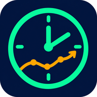
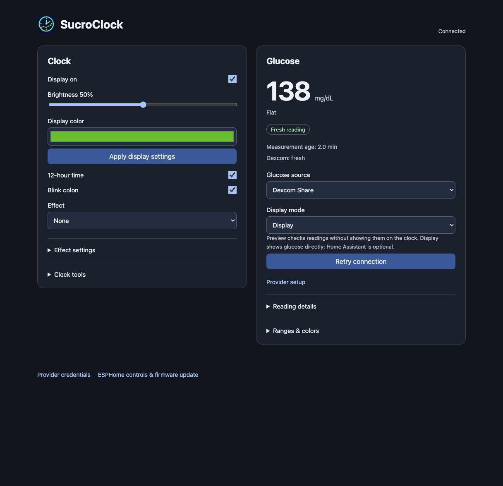

# SucroClock

**Your glucose, at a glance.**

An open-source ESP32 glucose clock for the HU-058D display. It connects directly
to your glucose provider and offers local web controls, configurable colors,
trend glyphs and firmware updates over Wi-Fi. Home Assistant is optional.

## Features

- Separate Dexcom Share, LibreLinkUp, Nightscout, SugarSense and Home Assistant sources.
- Local HTTPS setup and controls; provider credentials stored on the clock.
- Adjustable glucose ranges/colors, optional smooth blending and brief breathing alerts.
- Preview/Display modes, freshness checks and explicit source selection.
- Clock effects, brightness, buttons and custom trend glyphs.
- Browser OTA, native ESPHome OTA and fallback Wi-Fi provisioning.

*Interface preview using sample glucose data.*

## Start here

1. Check the [hardware and wiring](docs/wiring.md). This firmware targets an ESP32
   driving the HU-058D panel; it is not a firmware file for the stock controller.
2. Follow the [build and setup guide](firmware/esphome/README.md).
3. Open **https://sucroclock.local:8443/**, configure a provider, then select its
   source and **Display** mode. A provider test alone leaves the source unchanged.

Updating an existing Clock-O-Rama installation? Read the
[migration guide](firmware/esphome/docs/MIGRATION.md) first: the hostname,
certificate and Home Assistant action prefixes change.

An optional [Home Assistant automation example](firmware/esphome/examples/home-assistant/README.md) includes button displays and a brightness schedule.

## Project status

**0.1.0-dev — development preview.** Dexcom has been exercised on hardware.
LibreLinkUp/Nightscout use protocol and coordinator tests; live accounts have not
been verified in this project. SugarSense pairing is implemented and tested with
fixtures; live account pairing remains unverified. Provider APIs can change.
This is a secondary display; readings may be delayed or unavailable. It does not
replace the provider's app, alarms or treatment tools.

The physical display shows integer mg/dL. SugarSense currently displays the
paired account's own reading, not Care Circle selections. The clock's configured
colors apply independently of provider account ranges.

## Documentation

- [Providers](firmware/esphome/docs/PROVIDERS.md) · [SugarSense pairing](firmware/esphome/docs/SUGARSENSE.md)
- [Web controls](firmware/esphome/docs/CONTROLS.md) · [Glucose colors](firmware/esphome/docs/GLUCOSE-COLORS.md)
- [HTTPS and certificates](firmware/esphome/docs/HTTPS-SETUP.md)
- [Home Assistant entities and actions](docs/home-assistant.md)
- [Hardware](docs/hardware.md) · [Display mapping](docs/display-map.md)
- [Release preparation](firmware/esphome/docs/RELEASING.md)

[Initial release notes](CHANGELOG.md) describe the tested paths and remaining limits.

## Credits and license

SucroClock builds on **Adrian Black's HU-058_ESPHome project** and AiP33628 display
component. His hardware research, wiring instructions, upstream README and
license are retained. See [NOTICE](NOTICE), [LICENSE](LICENSE), and the
[upstream project](https://github.com/misterblack1/HU-058_ESPHome).
The SucroClock icon was generated for this project; its prompt and icon assets
are in `firmware/esphome/assets/`.
